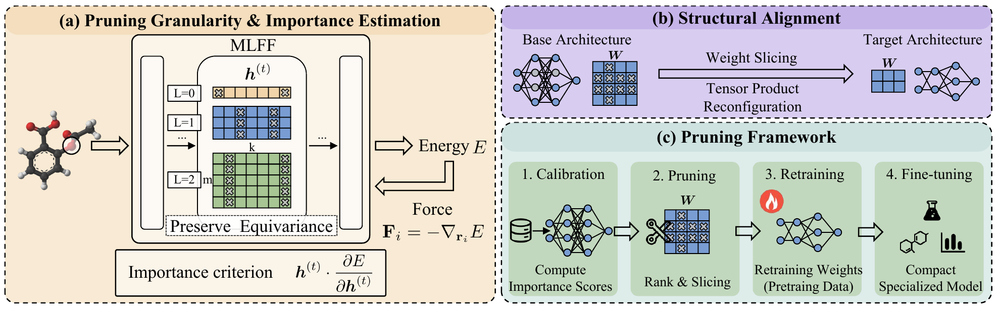

# [NeurIPS 2026 Oral] Compact SO(3) Equivariant Atomistic Foundation Models via Structural Pruning

[**Paper**](https://arxiv.org/abs/2605.08885)

This repository implements structural pruning for SO(3) equivariant atomistic foundation models. The method removes complete irreducible representation blocks along the channel and order dimensions, preserving equivariance. The compact models can be retrained on a subset of the pre-training data and fine-tuned for downstream tasks.

We provide the pruning scripts and retraining configurations used in our paper for **MACE-MP**, **MACE-OFF**, **SevenNet**, and **eSCN**.



## Setup

```bash
git clone https://github.com/HPC-AI-Team/SO3-Pruning.git
cd SO3-Pruning
```

Run all commands below from the repository root. Replace `/path/to/...` with your checkpoint, data, and output paths.

Use a separate environment for each model library. The scripts have been checked with the following package versions:

| Model | Package | Official repository |
| --- | --- | --- |
| MACE-MP and MACE-OFF | `mace-torch==0.3.14` | [MACE](https://github.com/ACEsuit/mace) |
| SevenNet | `sevenn==0.12.0` | [SevenNet](https://github.com/MDIL-SNU/SevenNet) |
| eSCN | `fairchem-core==1.10.0` | [FAIR-Chem](https://github.com/facebookresearch/fairchem) |

Install the package for the model you want to use in its environment:

```bash
# MACE environment
python -m pip install mace-torch==0.3.14 tqdm

# SevenNet environment
python -m pip install sevenn==0.12.0

# eSCN environment
python -m pip install fairchem-core==1.10.0
```

Follow the corresponding library's installation instructions for PyTorch, CUDA, and compiled dependencies.

## MACE

### Source checkpoints

`L` denotes the maximum hidden-feature order, and `C` denotes the channel count per order.

| Model | Source checkpoint | Source | Supported targets |
| --- | --- | --- | --- |
| MACE-MP | `MACE_MPtrj_2022.9.model` | L1 C256 | L0–L1, C1–C256 |
| MACE-MP | `2024-01-07-mace-128-L2_epoch-199.model` | L2 C128 | L0–L2, C1–C128 |
| MACE-OFF23 | `MACE-OFF23_large.model` | L2 C224 | L0–L2, C1–C224 |

Download the source checkpoints from the [MACE-MP release](https://github.com/ACEsuit/mace-foundations/releases/tag/mace_mp_0) and the [MACE-OFF23 repository](https://github.com/ACEsuit/mace-off/tree/main/mace_off23).

### 1. Compute channel importance scores

Calibration is needed only when reducing the channel count. Provide a representative structure subset in an ASE-readable format, such as extended XYZ:

```bash
python MACE/pruning/calibration.py \
    --model /path/to/MACE_MPtrj_2022.9.model \
    --data /path/to/calibration.xyz \
    --output /path/to/mp_scores.pt \
    --device cuda
```

The script computes Taylor channel importance scores and displays calibration progress. Use `--device cpu` for CPU calibration. For MACE-OFF, run the same script with the OFF source checkpoint and molecular calibration structures.

Use scores computed from the same source checkpoint that you will prune.

### 2. Prune the model

For combined order and channel pruning of MACE-MP, for example L1 C256 to L0 C128:

```bash
python MACE/pruning/prune_mp.py \
    --model /path/to/MACE_MPtrj_2022.9.model \
    --scores /path/to/mp_scores.pt \
    --target-l 0 \
    --target-channels 128 \
    --output /path/to/mp_pruned.model
```

For order-only pruning, keep all source channels and omit `--scores`:

```bash
python MACE/pruning/prune_mp.py \
    --model /path/to/2024-01-07-mace-128-L2_epoch-199.model \
    --target-l 0 \
    --target-channels 128 \
    --output /path/to/mp_l0.model
```

For MACE-OFF23 Large to L1 C128:

```bash
python MACE/pruning/prune_off.py \
    --model /path/to/MACE-OFF23_large.model \
    --scores /path/to/off_scores.pt \
    --target-l 1 \
    --target-channels 128 \
    --output /path/to/off_pruned.model
```

### 3. Retrain

Set the checkpoint, dataset, and output paths in [train_mp.sh](MACE/train_mp.sh) or [train_off.sh](MACE/train_off.sh), then run:

```bash
bash MACE/train_mp.sh
```

or:

```bash
bash MACE/train_off.sh
```

Training settings are in [mp.yaml](MACE/configs/mp.yaml) and [off.yaml](MACE/configs/off.yaml). The scripts load the pruned model through MACE's `--foundation_model` option.

## SevenNet

The pruning script converts **SevenNet-l3i5** to an L2 model with five interaction layers and hidden channels `128x0e+64x1e+32x2e`.

Download [`checkpoint_l3i5.pth`](https://github.com/MDIL-SNU/SevenNet/tree/main/sevenn/pretrained_potentials/SevenNet_l3i5), then run:

```bash
python SevenNet/pruning/prune.py \
    --model /path/to/checkpoint_l3i5.pth \
    --output /path/to/sevennet_pruned.pth
```

This fixed L3-to-L2 conversion does not require calibration scores.

For retraining, set `train.continue.checkpoint`, `data.load_trainset_path`, and `data.load_validset_path` in [SevenNet-0.yaml](SevenNet/configs/SevenNet-0.yaml). Prepare the structure data using SevenNet's data tools. Set the output directory in [train.sh](SevenNet/train.sh), then run:

```bash
bash SevenNet/train.sh
```

The example script runs on one GPU. The configured batch size is 1024. For distributed training, divide this global batch size by the number of GPUs when setting the per-GPU batch size.

## eSCN

Download the **eSCN-L6-M2-Lay12-S2EF-OC20-All+MD** checkpoint from the [official model list](https://github.com/facebookresearch/fairchem/blob/main/docs/catalysts/models.md).

For L6-to-L4 pruning:

```bash
python eSCN/pruning/prune.py \
    --model /path/to/escn_l6_m2_lay12_all_md_s2ef.pt \
    --target-l 4 \
    --output /path/to/escn_pruned.pt
```

The script reduces `lmax` while retaining `mmax`, channels, and layer count. It supports single-resolution eSCN checkpoints. The target must satisfy `mmax <= target_l < source_l`, so the L6 M2 source supports target L2–L5. Calibration scores are not needed.

For retraining, prepare the OC20 S2EF data in FAIR-Chem's LMDB format. Set the data paths in [train_1m.yml](eSCN/configs/train_1m.yml) or [train_2m.yml](eSCN/configs/train_2m.yml), and set the checkpoint and output paths in [train.sh](eSCN/train.sh):

```bash
bash eSCN/train.sh
```

The script uses 8 GPUs and selects `train_1m.yml` by default. This configuration samples one million structures from the 2M training split. Select `train_2m.yml` to use the full split. Both configurations use L4, so update `model.lmax_list` if you prune to another order.

## Acknowledgments

This implementation builds on [MACE](https://github.com/ACEsuit/mace), [e3nn](https://github.com/e3nn/e3nn), [SevenNet](https://github.com/MDIL-SNU/SevenNet), and [FAIR-Chem](https://github.com/facebookresearch/fairchem).

## Citation

If you find this work useful, please consider citing our paper:

```bibtex
@inproceedings{wang2026compact,
  title     = {Compact {SO(3)} Equivariant Atomistic Foundation Models via Structural Pruning},
  author    = {Wang, Chen and Hu, Siyu and Tan, Guangming and Jia, Weile},
  booktitle = {Advances in Neural Information Processing Systems},
  year      = {2026}
}
```
